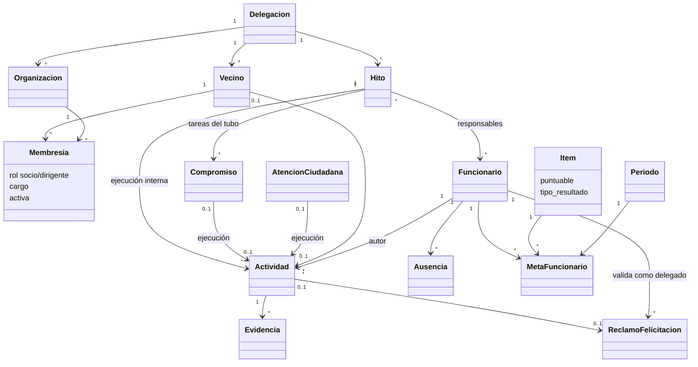

# Incremento territorial y reglas de puntuación

Fecha: 25 de octubre de 2026. Fuente: los 13 requerimientos entregados por el usuario.

## Comparación con el sistema anterior y trazabilidad

| ID | Antes de este incremento | Implementación incorporada | Pruebas principales (`core/test_requerimientos.py`) |
|---|---|---|---|
| RF-N01 Vecinos | Solo nombres de contacto en actividades y atenciones; sin entidad Vecino | Alta, consulta, modificación y desactivación; nombre, teléfono, dirección opcional, territorio y delegación. Pertenencia mediante Membresia | `test_crud_vecino_y_desactivacion_preserva_relacion`, `test_desactivar_vecino_no_borra_actividad_historica` |
| RF-N02 Organizaciones | Ausente | Juntas/organizaciones con domicilio legal, territorio, delegación, socios opcionales, fechas y registros; desactivación sin eliminar relaciones | `test_crud_organizacion_y_membresia`, `test_membresia_rechaza_otra_delegacion` |
| RF-N03 Hitos | Existía agenda colectiva, sin hitos ni recurrencia | Hito con recursos, responsables, fechas, estado y periodicidad. Creación por delegado/administrador. Compromiso vinculado al hito como tarea del tubo; ejecución vinculada como Actividad interna | `test_hitos_solo_delegado_o_administrador`, `test_post_hito_crea_responsables_y_tarea`, `test_ejecucion_de_tarea_hito_es_interna` |
| RF-N04 Beneficiario delegado | Ausente | Beneficiario municipal explícito; si tiene rol delegado, se fuerza Otra gestión y no puntúa | `test_delegado_beneficiario_fuerza_otra_gestion` |
| RF-N05 Contacto para puntuar | Campos opcionales sin efecto en puntuación | Sin nombre o teléfono se conserva el registro, pero no puntúa. Vecino puede completar contacto. Atención tiene teléfono independiente y una ejecución vinculada | `test_contacto_incompleto_se_conserva_sin_puntaje`, `test_atencion_sin_telefono_no_puntua_mediante_ejecucion` |
| RF-N06 Máximo diario | Ausente | Siete actividades potencialmente puntuables por funcionario/fecha, incluyendo pendientes de evidencia. Validación en formulario y al guardar dentro de transacción | `test_octava_actividad_rechazada_desde_modelo_y_formulario`, `test_completar_datos_no_permite_eludir_limite` |
| RF-N07 Cierre semanal | Solo se rechazaban fechas futuras | Se permite hasta el lunes siguiente inclusive; desde martes se bloquea ingreso, modificación y eliminación. Se comprueba fecha original para impedir mover un registro cerrado | `test_lunes_siguiente_abierto_y_martes_cerrado`, `test_no_se_puede_mover_actividad_cerrada_a_otra_semana` |
| RF-N08 Coordinaciones | Sin clasificación excluyente | Coordinación y Otra gestión se conservan sin puntaje. La ejecución final es un registro distinto con respaldo | `test_coordinacion_y_otra_gestion_no_puntuan` |
| RF-N09 Catálogo puntuable | Había ítems por cargo; toda actividad con evidencia aprobada sumaba | Ítem vigente, puntuable y con resultado admitido: ejecución final o felicitación validada. Correspondencia con clasificación y cargo | `test_catalogo_no_puntuable_no_genera_resultado`, `test_felicitacion_exige_item_de_felicitaciones` |
| RF-N10 Tope 120 % | Cumplimiento sin tope; ponderado limitado a 150 % | Cumplimiento y ponderado limitados a 120 %. Al registrar después del tope, se marca el registro sin puntaje y se conserva sin consumir cupo diario | `test_tope_120_conserva_ejecuciones_adicionales`, `test_alcanzar_tope_permite_mas_de_siete_registros_sin_puntaje` |
| RF-N11 Felicitaciones | Registro y aviso a coordinación; sin respaldo ni validación del delegado | Origen vecinal, destinatario delegado/delegación, respaldo formal, contacto, vínculo único a ejecución e intervención explícita del delegado. Cambios materiales revocan validación | `test_felicitacion_validada_cuenta_una_vez`, `test_felicitacion_sin_respaldo_o_sin_vecino_no_se_valida`, `test_solo_delegado_valida_y_post_no_admite_suplantacion` |
| RF-N12 Ausencias | Ausente | Delegado registra/cancela días libres, vacaciones, administrativos, licencias u otras ausencias justificadas. Ajuste de metas y semáforo por días hábiles | `test_ausencia_proporcional_sin_duplicar_superposiciones`, `test_ausencia_en_feriado_no_reduce_meta`, `test_ausencia_cancelada_restablece_meta` |
| RF-N13 Indicadores colectivos | Tablero individual y promedio por delegación, sin ajuste de ausencias ni distribución | Resultados individuales, equipos por cargo, territorios y delegación; distribución verde/ámbar/rojo/sin meta; funcionarios e ítems bajo cumplimiento | `test_tablero_no_diluye_resultados_con_personas_sin_metas`, `test_paginas_nuevas_renderizan_y_tablero_limita_delegacion` |

Ninguno de los 13 estaba completamente cubierto con las condiciones nuevas. RF-N03, N05, N09, N10, N11 y N13 tenían componentes reutilizables.

## Reglas de negocio y decisiones de cálculo

- RN-N01: el rol de dirigente reside en Membresia, no en Vecino. Una persona puede tener relaciones con varias organizaciones; cada pareja vecino/organización es única. Desactivar conserva historia.
- RN-N02: los perfiles operativos actúan en su delegación. Administración/coordinación pueden consultar transversalmente. Solo delegado o administrador crea/edita hitos. Solo el delegado de la delegación registra ausencias y valida felicitaciones.
- RN-N03: una ejecución corresponde a un ítem del cargo del funcionario. La clasificación es explícita; no se intenta deducir de palabras en la descripción.
- RN-N04: debe registrarse el beneficiario municipal cuando sea el delegado. El sistema no puede identificarlo de manera fiable a partir de un nombre libre.
- RN-N05: una ejecución requiere contacto completo y evidencia aprobada. Una felicitación requiere validación formal del delegado, en lugar de usar la foto como sustituto de esa validación. Varias evidencias no multiplican una ejecución.
- RN-N06: las tareas futuras de hitos son Compromisos (tubo); las Actividades son ejecuciones realizadas. Una tarea o una atención tiene como máximo una ejecución vinculada. Los hitos siempre originan actividad interna, aunque el cliente envíe origen externo.
- RN-N07: el límite de siete cuenta candidatos a puntuar, aun pendientes de evidencia, para evitar registrar ilimitados pendientes y aprobarlos después. Los registros sin contacto, coordinaciones, otras gestiones y posteriores al tope no consumen cupo.
- RN-N08: fecha de cierre = lunes inicial de la semana + 8 días, a las 00:00 de America/Santiago. Se permiten registros hasta el lunes siguiente. Para actividades de fin de semana se usa el mismo cierre de su semana; no se impide documentar festivales de sábado/domingo. No hay permiso excepcional de reapertura.
- RN-N09: la revisión del verificador y la validación del delegado pueden ocurrir después del cierre, sobre el registro ya existente. El autor no puede modificarlo ni agregar evidencia desde la pantalla una vez cerrado.
- RN-N10: cumplimiento = mínimo(120, ejecuciones válidas / meta ajustada × 100). El ponderado del ítem usa ese cumplimiento limitado. El avance contabiliza unidades válidas, no el exceso conservado solo como trazabilidad.
- RN-N11: cuando todas las metas aplicables del ítem ya están a 120 %, un nuevo registro queda marcado permanentemente `sin_puntaje_por_tope`. Se informa la causa en su detalle; una posterior modificación de metas no transforma automáticamente ese registro en puntuable. Esta decisión preserva el motivo registrado al ingresar el exceso.
- RN-N12: confirmado por el usuario: días laborables = lunes a viernes, excluyendo feriados públicos chilenos. Se usa `holidays` para Chile, subdivisión Coquimbo; no se incluyen días exclusivos de bancos. Nuevos feriados extraordinarios requieren actualizar la biblioteca/calendario antes de evaluar el período afectado.
- RN-N13: meta ajustada = meta original × días hábiles disponibles / días hábiles del período. Se recortan ausencias a los límites del período y se unen intervalos para no descontar dos veces un día. No se redondea a entero. Se conservan las metas originales.
- RN-N14: avance esperado personal = días hábiles disponibles transcurridos / días hábiles disponibles totales. Verde si cumple ese avance, ámbar si alcanza la proporción configurada en `umbral_ambar`, rojo en otro caso. Un período sin días disponibles se muestra sin meta evaluable y se excluye del promedio.
- RN-N15: resultado individual = promedio de cumplimiento de sus ítems evaluables, ponderado por sus pesos; resultado colectivo = promedio de resultados individuales evaluables. Los funcionarios sin metas se muestran por separado y no diluyen el resultado. Equipo = cargo dentro de delegación; territorio = campo del funcionario, con sector de delegación como respaldo.
- RN-N16: confirmado por el usuario: una felicitación válida cuenta como una ejecución del ítem de felicitaciones con su propia meta y ponderador. No se agrega una bonificación separada ni se cuenta dos veces la actividad vinculada.
- RN-N17: cambiar contenido material de una actividad vuelve sus evidencias aprobadas a pendientes y revoca la validación de la felicitación vinculada. Cambiar el contenido de la felicitación también revoca su validación.

## Historias, criterios de aceptación y casos de uso

| Historia / caso de uso | Actor y flujo | Criterio de aceptación |
|---|---|---|
| HU/CU-N01 Gestionar vecino | Funcionario abre Vecinos, crea datos, consulta y edita; desactiva por POST | Nombre, teléfono, territorio y delegación requeridos; dirección opcional; se conserva el ID y sus relaciones al desactivar |
| HU/CU-N02 Gestionar organización y dirigentes | Operador registra organización y luego pertenencia con rol/cargo | Datos jurídicos y fechas presentes; socio/dirigente asociado a la relación, no a la persona; rechazo de relaciones entre delegaciones diferentes |
| HU/CU-N03 Programar hito | Delegado/administrador define hito, responsables y recurrencia; crea tareas desde detalle | Funcionario/coordinación no pueden crear hitos; responsables de la delegación; periodicidad obligatoria si recurrente |
| HU/CU-N04 Ejecutar tarea interna | Responsable abre tarea del hito y registra ejecución, contacto y evidencia | Origen interno automático; vínculo único; evidencia pendiente; tarea permanece consultable en agenda |
| HU/CU-N05 Registrar actividad | Funcionario selecciona clasificación, beneficiario e ítem; guarda y adjunta respaldo | Mensajes claros para octava candidata, fecha futura o semana cerrada; datos incompletos se guardan sin puntaje |
| HU/CU-N06 Revisar ejecución | Verificador aprueba/rechaza evidencia | Solo aprobadas elegibles suman; coordinaciones, Otra gestión y beneficiario delegado no suman ni con evidencia aprobada |
| HU/CU-N07 Formalizar felicitación | Se registra actividad de tipo Felicitación con ítem admitido; se registra felicitación con respaldo y vínculo; delegado valida | Un POST de otro perfil es rechazado; mensaje personal o falta de respaldo impide validar; se registra autor y fecha de validación |
| HU/CU-N08 Registrar ausencia | Delegado registra período/tipo/justificación, consulta o cancela | Se ajustan metas y semáforo sin modificar meta original; no se descuentan feriados ni fines de semana; no hay doble descuento por solapamiento |
| HU/CU-N09 Consultar tablero | Jefatura elige período y consulta consolidado, distribución y bajos | Resultados limitados a delegación para delegado; desglose por funcionario, cargo y territorio; metas ajustadas y tope consistentes |
| HU/CU-N10 Completar solicitud | Autor o coordinación edita teléfono/nombre de atención y registra su ejecución | Edición bloqueada tras cierre semanal; completar contacto revalida cupo diario y no permite eludir la octava actividad |

## Requerimientos no funcionales

- RNF-N01: autorización en servidor en cada lectura/escritura de los módulos nuevos; no depende de ocultar botones.
- RNF-N02: creación/modificación/desactivación territorial y validación formal generan auditoría; relaciones históricas usan PROTECT y desactivación lógica.
- RNF-N03: límite diario revalidado dentro de transacción al guardar Actividad; bloqueo de escritura por funcionario compatible con SQLite mediante actualización sin cambio de `last_login`. La validación del formulario por sí sola no decide el cupo.
- RNF-N04: migraciones aditivas con valores predeterminados; no se borran tablas ni se rellenan datos personales inventados. Respaldo SQLite antes de aplicarlas.
- RNF-N05: pruebas automáticas con base aislada, casos de borde y regresión de las pantallas anteriores. Esto verifica los escenarios cubiertos, no constituye una garantía de ausencia absoluta de errores ni una prueba de carga en AWS.
- RNF-N06: respaldo formal de felicitaciones con límite de 10 MB; se mantiene el mecanismo de almacenamiento de archivos del proyecto.

## Modelo de clases y datos

Tablas nuevas: `core_vecino`, `core_organizacion`, `core_membresia`, `core_hito`, `core_hito_responsables`, `core_ausencia`.
Restricciones: vecino/organización únicos en membresía; ejecución de tarea y de atención únicas; felicitación vinculada a actividad única. Los campos de contacto previos se conservan como datos históricos.
Migraciones: `0003_comunidad_puntuacion_ausencias`, `0004_solicitud_contacto_opcional`, `0005_catalogo_y_tope_trazable`.

## Plan de pruebas y puesta en marcha

1. Ejecutar `python manage.py check` y `python manage.py makemigrations --check --dry-run`.
2. Ejecutar `python manage.py test core --noinput`: pruebas anteriores de CRUD/interfaz y casos nuevos en `test_requerimientos.py`.
3. Crear respaldo consistente con la API `sqlite3.Connection.backup`; aplicar `python manage.py migrate`.
4. Comparar cantidades de registros de las tablas anteriores y ejecutar `PRAGMA quick_check` y `PRAGMA foreign_key_check`.
5. Probar con perfiles funcionario, delegado y coordinación los CU-N01 a CU-N10. Crear ítems cuyo resultado admitido sea Felicitación, asignar metas y territorio a los funcionarios antes de evaluar resultados.

Los registros históricos sin contacto completo ahora se excluyen del puntaje, aunque tengan evidencia aprobada. No se inventan teléfonos ni se reabren semanas automáticamente. Los ítems existentes se conservan habilitados como ejecuciones finales; coordinación debe revisar qué acciones del catálogo son efectivamente puntuables y cuáles admiten felicitaciones.

La recurrencia guarda la indicación y periodicidad del hito. El requerimiento no solicita generar automáticamente futuras ediciones ni enviar invitaciones; esas automatizaciones no forman parte de este incremento. Tampoco se implementa un permiso especial de reapertura, que el documento deja para una definición posterior.

Referencia del calendario utilizado: https://holidays.readthedocs.io/en/latest/auto_gen_docs/chile/
